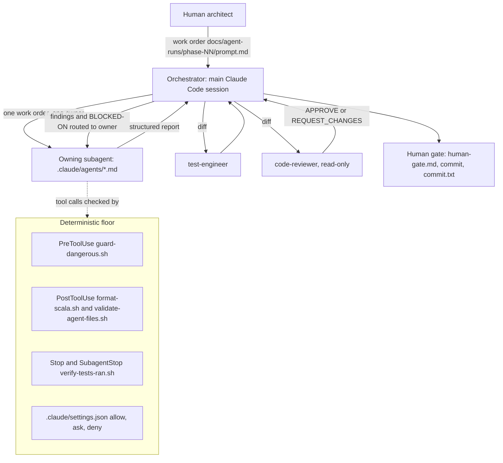
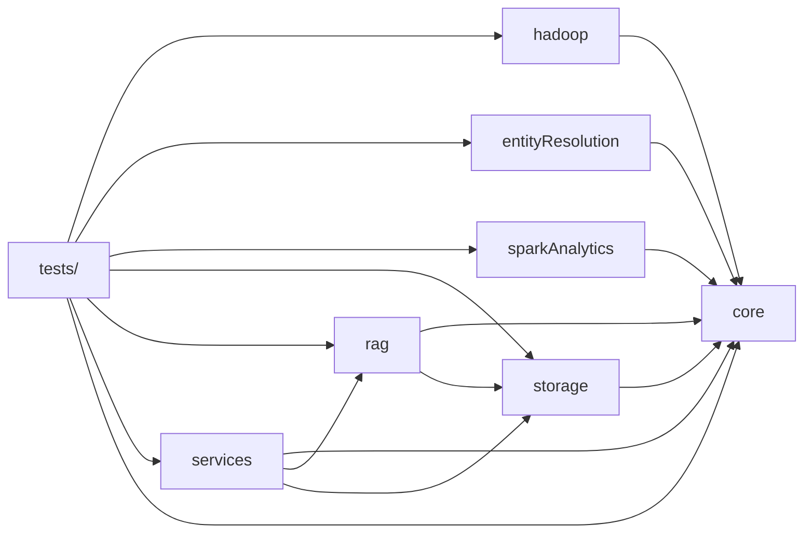
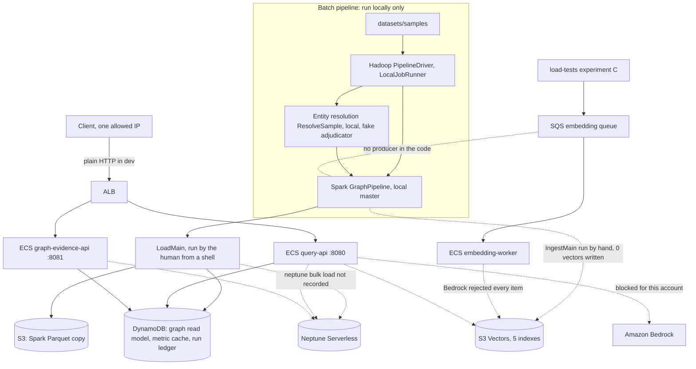
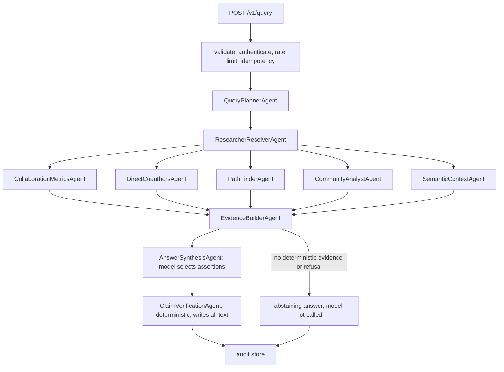

# ScholarChain architecture

Phase 17, part 1. Written from the repository at commit `5862b7b` and the
archived phase evidence. Related documents:
[data lineage](data-lineage.md), [API reference](api-reference.md),
[threat model](threat-model.md), [service limits](service-limits.md),
[evaluation](evaluation.md), [ownership map](agents.md) (owned by
`factory-engineer`, referenced here, not rewritten).

Status words used below:

| Word | Meaning |
|---|---|
| Implemented | Code exists and has automated tests with fakes or local runs |
| Observed | Seen to run in the cloud or locally; the evidence file is cited |
| Not wired | Code exists, but nothing in the runtime or deployment calls it |
| Not run | Designed or coded, never executed against the real service |
| Not implemented | No code |

## 1. Build time: the agent factory

Rules (source: [agents.md](agents.md), [CLAUDE.md](../CLAUDE.md)):
one writer per artifact, subagents never call each other, reviewers have no
write tools, `terraform apply`/`destroy` and git commits are human-only.
`project/Dependencies.scala` is the one file with two writers, split by field.

The agent catalog is in the [README](../README.md#agent-catalog). How often the
factory blocked, repaired or needed manual action is in
[evaluation.md section 4](evaluation.md#4-agentic-factory).

## 2. Module graph

Source: [build.sbt](../build.sbt). `hadoop`, `entityResolution` and
`sparkAnalytics` never depend on each other; they exchange versioned files whose
schemas are in `core`. The ports-only rule for `rag` over `storage` is enforced
by review, not by the build
([phase-08 gate](agent-runs/phase-08/human-gate.md)).

## 3. Runtime and data architecture as built

Solid arrows are paths that exist in code and have been observed at least once.
Dashed arrows are implemented but not observed, or not wired.

### 3.1 What is observed, and what is not

| Component | State | Evidence |
|---|---|---|
| Hadoop MapReduce pipeline | Observed locally on committed samples. **Not run on EMR** | Replayed for this document (see [README](../README.md#replay-record)); [EMR listing empty](../experiments/evaluation/raw/partA-1b0e893-20261126T014300Z/aws/emr-list-clusters.json) |
| Entity resolution | Observed locally, deterministic **fake** adjudicator only. No EMR entry point | [evaluation.md section 1](evaluation.md#1-entity-resolution); [phase-12 gate, M8](agent-runs/phase-12/human-gate.md) |
| Spark graph analytics | Observed locally. **Not run on EMR** | [evaluation.md section 2](evaluation.md#2-graph-correctness) |
| EMR cluster, Step Functions pipeline | Terraform exists (`enable_emr`); not created | [infra README](../infra/terraform/README.md), [phase-12 gate](agent-runs/phase-12/human-gate.md) |
| DynamoDB load of the serving run | Observed (843 items) | [phase-14 gate, update](agent-runs/phase-14/human-gate.md), [load-live.log](agent-runs/phase-14b/load-live.log) |
| S3 copy of Spark output | First attempt failed; a later copy matched the local manifest for 21 of 21 tables | [load-live.log](agent-runs/phase-14b/load-live.log), [evaluation.md 2.1](evaluation.md#21-input-and-copy-integrity) |
| Neptune | Cluster applied. **No bulk load and no graph query result is recorded.** The loader step exists (`LoadMain --targets neptune`) | [phase-14 gate](agent-runs/phase-14/human-gate.md); the S3 listings in [graph/](../experiments/evaluation/raw/partA-1b0e893-20261126T014300Z/graph/) show no `neptune-export/` object |
| S3 Vectors | Bucket and 5 indexes applied. **No vector write observed** (experiment C: 0 written) | [phase-15 gate](agent-runs/phase-15/human-gate.md), [evaluation.md 3](evaluation.md#3-performance-and-elasticity) |
| Bedrock (embedding, planner, synthesis) | **Blocked** account-wide (`NOT_AUTHORIZED`). No live model call has succeeded | [bedrock-evidence.txt](agent-runs/phase-15/bedrock-evidence.txt) |
| query-api, graph-evidence-api | Observed running on ECS (1 task each at last deploy, commit `3c3e1a1`) | [deploy report](agent-runs/phase-15/deploy-report-3c3e1a1.md) |
| Evidence-backed query answer | **Never observed.** Smoke 7 of 8; the `evidence` check fails | [smoke log](agent-runs/phase-15/smoke-test-transcribed.log) |
| embedding-worker | Scaled 0 to 2 to 0 once; processed no item successfully | [experiment C report](agent-runs/phase-15/experiment-C-report.md) |
| Embedding queue producer | **Not implemented**: nothing in the application enqueues work items | [infra README, mismatch 1](../infra/terraform/README.md) |
| Researcher name directory, edge support, analytics readers | Wired to the DynamoDB graph read model | `modules/services/src/main/scala/scholarchain/services/entrypoint/QueryApiMain.scala` |
| `maxConcurrentLlmCalls`, verification model ID | Loaded from configuration, **not used** by any runtime code | search of `modules/*/src/main` |
| OpenSearch (optional) | **Not implemented**, not deployed | [infra README](../infra/terraform/README.md) |
| OpenTelemetry (optional) | **Not implemented** | no dependency in `project/Dependencies.scala` |
| GitHub Actions (optional) | **Not implemented** | no `.github/` directory |
| TLS on the dev ALB | **Not enabled** (no certificate) | [threat model](threat-model.md) |

## 4. Query workflow

Sources: `modules/rag/src/main/scala/scholarchain/rag/workflow/AnswerWorkflow.scala`,
`answer/AnswerSynthesisAgent.scala`, `answer/ClaimVerificationAgent.scala`.
Exercised with a scripted fake model only
([phase-09 gate](agent-runs/phase-09/human-gate.md)).

Design points:

- Graph facts and semantic context are separate sections of the evidence bundle.
  Counts, paths, components, communities and bridge measures come from graph or
  metric stores, never from vector similarity.
- The model returns structured assertions, not prose. Code verifies each one
  against the bundle and renders every sentence.
- Planner prompt `query-planner-prompt-v1` (schema `query-plan-v1`); synthesis
  prompt `answer-synthesis-prompt-v3` (schema `answer-synthesis-v2`); hashes in
  [prompts/manifest.json](../prompts/manifest.json).
- Asynchronous jobs are stored in DynamoDB and run **in process**; there is no
  job queue. A job can stay `RUNNING` forever (deferred defect T7,
  [phase-11 gate](agent-runs/phase-11/human-gate.md)).

## 5. Services and store roles

| Service | Port | Routes | Needs |
|---|---|---|---|
| query-api | 8080 | `/v1/query`, `/v1/jobs/...`, `/v1/explain/...` | DynamoDB, Neptune, S3, S3 Vectors, Bedrock, Secrets Manager |
| graph-evidence-api | 8081 | `/v1/graph/...`, `/v1/evidence/...` | Neptune, DynamoDB, Secrets Manager |
| embedding-worker | 8082 | health only | SQS, S3, DynamoDB, S3 Vectors, Bedrock |

| Store | Role |
|---|---|
| Neptune | Topology, direct coauthors, bounded paths (read-only runtime role) |
| DynamoDB | Run ledger, query sessions and jobs, evidence, artifact registry, entity-link cache, graph read model, researcher metric cache (seven tables) |
| S3 | Authoritative text and objects; raw, curated, graph, rag, artifacts, logs buckets |
| S3 Vectors | Embeddings with compact metadata in five indexes |

Elasticity: query-api 1-3 tasks and graph-evidence-api 1-2 tasks on CPU target
tracking; embedding-worker 0-2 tasks on SQS depth step scaling
([infra README](../infra/terraform/README.md)).
