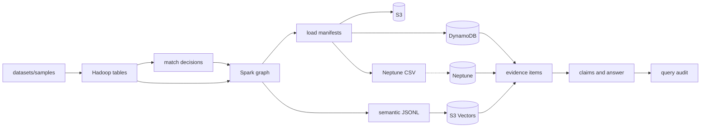

# ScholarChain data lineage

Source dataset to answer, with the real paths and schema versions. State words
(observed, not run, not wired) are defined in
[architecture.md](architecture.md). The scale is a **bounded sample**: 24 DBLP
works, 89 researchers, 334 coauthor edge rows over six windows. The course
minimums (100,000 works, 1,000,000 edges, 10,000 embedded chunks) are **not
met**.

## 1. Lineage chain

## 2. Source datasets

Manifest: [datasets/dataset-manifest.yaml](../datasets/dataset-manifest.yaml)
(`manifest_schema_version: 1`). Sample checksums:
[datasets/samples/SHA256SUMS](../datasets/samples/SHA256SUMS) (7 of 7 `OK` when
replayed on 2026-11-25).

| Dataset | Snapshot | Committed sample | Role | Schema note |
|---|---|---|---|---|
| DBLP XML (CC0-1.0) | 2026-11-01 | `dblp/dblp-2026-11-01-excerpt.xml`, `dblp/dblp-2023-06-28.dtd` | seed works and author order | [dblp.md](../datasets/schemas/dblp.md) |
| OpenAlex (CC0-1.0) | 2026-10-14 (snapshot excerpts); API-linked file undated | `openalex/*.jsonl` | author IDs, institutions, topics | [openalex.md](../datasets/schemas/openalex.md) |
| ORCID (CC0-1.0) | 2026-10-13 | one public record XML | identifier evidence | [orcid.md](../datasets/schemas/orcid.md) |
| Crossref | retrieval date 2026-11-20 | `crossref/crossref-works-api-linked.jsonl` | DOI metadata | [crossref.md](../datasets/schemas/crossref.md) |

Full-dataset download mode has never run against the live servers
([phase-03 gate](agent-runs/phase-03/human-gate.md)).

## 3. Hadoop (`scholarchain.hadoop.driver.PipelineDriver`)

Job contracts: [modules/hadoop/JOBS.md](../modules/hadoop/JOBS.md).

- Layout: `<outputRoot>/<dataset>/<table>/snapshot=<label>/run_id=<hex>/part-*.gz`
  plus `counters.json` and `_SUCCESS`.
- Jobs: J01 extract, J01C cap, J02 source normalize, J03 exact identifiers,
  J05/J05b blocking, J06 candidates, J07 publication teams and coauthor pairs,
  J09 graph-candidate export (`scholarchain/spark_<table>`).
- Run manifest: `run-manifest-v1` at `scholarchain/run_manifest/...`. Policy
  versions recorded: `matchFeatureVersion`, `sourceEdgePolicyVersion`.
- Rejects: `reject-v1` rows in `<dataset>/rejects_<job>/`.

| Record | Schema version |
|---|---|
| work | `work-v1` |
| author mention | `author-mention-v1` |
| author-paper | `author-paper-v1` |
| coauthor-pair candidate | `coauthor-pair-candidate-v2` (v1 still decodable) |
| match candidate | `match-candidate-v1` |
| exact-identifier outcome | `exact-identifier-outcome-v1` |

All versions: `modules/core/src/main/scala/scholarchain/core/schema/SchemaVersions.scala`.
Every record carries `provenance-v1` (source dataset, source record ID,
snapshot, run ID, and policy, model and prompt versions where applicable).

**Replayed 2026-11-25** on the committed samples: run ID
`run:fa68b48b0cfb87ca7514ba90feeeabdb926a3cb60fb6a9483affdb4169fdb315`, the same
ID that `modules/spark/config/local-run.properties` records; 24 works kept,
maximum team size 8, largest pair expansion 28, largest blocking group 3.

## 4. Entity resolution (`scholarchain.er.run.ResolveSample`)

- Input: Hadoop output root. Output:
  `<root>/run_id=<hex>/decisions/{accepted,rejected,unresolved,conflict}.jsonl`
  (`match-decision-v1`), `decision-index.csv`, `run-manifest.json`,
  `summary.json`.
- Policy `er-v1`, revision `er-v1-r2`, features `er-features-v2`; thresholds and
  cutoffs in `modules/entity-resolution/config/er-v1-thresholds.properties`.
- Adjudicator: `fake` only (`fake-deterministic-adjudicator-v1`, prompt
  `er-adj-prompt-v1`). `--adjudicator bedrock` is refused by the entrypoint.
- Committed runs: `modules/entity-resolution/local-run/er-v1/`.

**Replayed 2026-11-25**: run ID `run:ea28cea8...`, researcher ACCEPTED 59,
CONFLICT 1, UNRESOLVED 11; work ACCEPTED 18, CONFLICT 2, REJECTED 1. The counts
equal the committed run `run:74494228...`; the run ID differs because it covers
a code fingerprint
([known limitations](../modules/entity-resolution/KNOWN-LIMITATIONS.md)).
Quality metrics: [evaluation.md section 1](evaluation.md#1-entity-resolution).

## 5. Spark (`scholarchain.spark.run.GraphPipeline`)

Job notes: [modules/spark/JOBS.md](../modules/spark/JOBS.md). Identity rule
`sc-identity-cluster-rule-v1` uses ACCEPTED links only.

| Output (under `graph/`) | Record schema | Metric or policy version | Rows in replay |
|---|---|---|---:|
| `nodes/type=researcher` | `researcher-v1` | identity rule | 89 |
| `nodes/type=work` / `venue` / `topic` / `institution` | `work-v1`, `venue-v1`, `topic-v1`, `institution-v1` | | 24 / 13 / 63 / 32 |
| `edges/type=authored` | `authorship-v1` | | 89 |
| `edges/type=coauthored_with` | `coauthor-edge-v1` | `sc-coauthor-edge-policy-v1` | 334 |
| `edges/type=coauthored_with_support` | `coauthor-edge-support-v1` | | 334 |
| `metrics/type=researcher_collaboration` | `researcher-metrics-v1` | `sc-collaboration-metrics-v1` | 178 |
| `metrics/type=components` | `component-membership-v1` | `sc-components-min-label-v1` | 178 |
| `metrics/type=communities` | `community-membership-v1` | `sc-communities-lpa-sync-v1` | 178 |
| `metrics/type=bridges` | `bridge-measures-v1` | `sc-bridge-measures-v1` (no betweenness) | 178 |
| `metrics/type=coreness` | `coreness-v1` | `sc-kcore-peeling-v1` | 178 |
| `edges/type=cross_community` | `cross-community-edge-v1` | | 0 |
| `paths/type=path_evidence` | `path-evidence-v1` | `sc-shortest-path-bfs-lexmin-v1` | 28 |
| `semantic/type=semantic_fact` | `semantic-fact-v1` | `sc-semantic-facts-v1` | 278 |
| `temporal/type=researcher_window_change` | `researcher-window-change-v1` | `sc-temporal-window-change-v1` | 123 |
| `identity/type=identity_conflict`, `rejects/type=integrity` | `identity-conflict-v1`, `reject-v1` | | 0 / 0 |
| `load-manifests/target=neptune\|dynamodb\|s3vectors-input\|s3` | `load-manifest-v1` | SHA-256 per file | |
| `semantic-jsonl/{semantic-facts,paths,papers}.jsonl` | input of `IngestMain` | | |

**Replayed 2026-11-25** with `--local --code-version 5862b7b` over the two
replayed runs above: run ID
`run:daeec71330266366633f9bedd0bc6146dd865f1916e3d64d8d1caa5f0ec283f0`. A
second replay gave the same run ID; Parquet file counts differed slightly, so
file-level output is not byte-stable.

The data served in dev comes from an earlier **local** run,
`run:f6023de34a312366583b3eacbc2b2a689234cf1abe79e184fb66875bac297a60`
(snapshot 2026-11-01, Spark code `a75b607`).

## 6. Stores (`scholarchain.storage.loader.LoadMain`)

`LoadMain --spark-output <dir> --run-id run:<hex> --snapshot <label> [--dry-run]
[--targets dynamo,s3,neptune-csv,neptune]`. The loader verifies each manifest
(SHA-256, size, row count) before writing, writes conditionally, and records
rejects.

| Target | What is written | Dry run replayed 2026-11-25 | Cloud state |
|---|---|---|---|
| `dynamo` | graph read model (`pk`/`sk`), researcher metric cache, run ledger entry | 0 rejects | Observed: 843 read-model items ([phase-14 gate](agent-runs/phase-14/human-gate.md)) |
| `s3` | Spark files under `run_id=<hex>/` | 458 objects planned | First attempt failed on a path bug; a later copy matches 21 of 21 tables ([evaluation.md 2.1](evaluation.md#21-input-and-copy-integrity)) |
| `neptune-csv` | openCypher CSV under `neptune-export/run_id=<hex>/csv/` in the rag bucket | 221 node IDs, 435 relationships, 0 rejected rows | **No staged CSV appears** in the archived S3 listings |
| `neptune` | starts the Neptune bulk load | not run | **No recorded load** |
| S3 Vectors (`IngestMain` or embedding-worker) | `vector-key-v1` keys, `vector-metadata-v1` metadata, documents in S3 | not replayed (see below) | **No vector written** ([phase-15 gate](agent-runs/phase-15/human-gate.md)) |

Not exported to the graph, because Spark produces no source table:
`PUBLISHED_IN`, `AFFILIATED_WITH`, `RESOLVES_TO`, `DERIVED_FROM`,
`SUPPORTED_BY` ([phase-07 gate](agent-runs/phase-07/human-gate.md)).

`IngestMain --dry-run` was attempted on 2026-11-25 without configuration and
exited 2 (`MISCONFIGURED`, listing the missing `SCHOLARCHAIN_RAG_*` and
ingestion variables). It was not run further.

Vector indexes: researcher profile, collaboration community, paper abstract,
collaboration path, topic-institution summary (names from configuration).
Dimension 1024, cosine. Non-filterable metadata keys: `textS3Uri`, `textHash`,
`embeddingModel`, `embeddingModelVersion`, `runId`, `schemaVersion`.

## 7. Evidence, answer, audit

| Object | Schema version | Provenance link |
|---|---|---|
| query plan | `query-plan-v1` | query ID = stable hash of the canonical request |
| evidence item | `evidence-v1` | ID over evidence type, referenced IDs, run ID |
| evidence bundle | `evidence-bundle-v1` | graph and semantic sections kept apart |
| claim | `answer-claim-v1` | `evidenceIds`, `verificationStatus` |
| answer | `answer-response-v1` | `evidenceBundleId` |
| audit record | `query-audit-v1` | plan, IDs, versions, tokens, latency, verification, answer hash |

Trace from an edge back to source: `coauthored_with.edgeId` ->
`coauthored_with_support` (supporting work ID) -> `authored` -> Hadoop author
mention -> author name and position in the DBLP XML. Audited on 50 of 334 edge
rows: 50 of 50 traced ([evaluation.md 2.9](evaluation.md#29-provenance-audit-of-50-edges)).

**Observed end of the chain:** `POST /v1/query` returned 200 in dev but with no
evidence ID ([smoke log](agent-runs/phase-15/smoke-test-transcribed.log)). No
evidence item, claim or verified answer has been observed from real data. The
answer end of the lineage is demonstrated only by automated tests with fakes.
