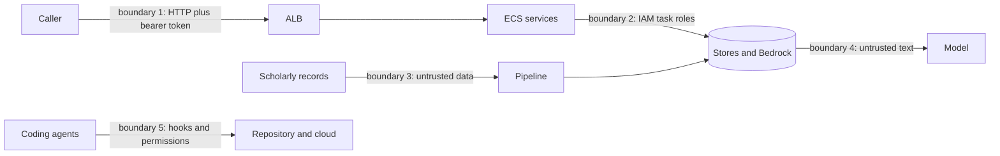

# ScholarChain threat model

Covers every threat in the course specification's "Security requirements"
section. No secret, token, credential or account ID appears here. Status words:
**Mitigated** (control implemented and tested or observed), **Partial**,
**Open**.

## 1. Assets and trust boundaries

Assets: API bearer tokens, task-role credentials, the API-key digest secret,
graph, metric and audit data, evidence text, Terraform state, the repository and
its agent constitution.

## 2. Observed security findings (read first)

### 2.1 Credentials written to DEBUG logs (Phase 15)

Incident
[INC-20261125-debug-credential-logging](incidents/INC-20261125-debug-credential-logging.md).
Status: **CONTAINED, not resolved.**

- Cause: the services shipped no production `logback.xml`, so Logback defaulted
  to DEBUG and the AWS SDK and HTTP wire loggers recorded signed request headers
  (temporary access key IDs and session tokens) and the body of the API-key
  secret read (token **digests**, key IDs and scopes by design). The incident
  searches found no secret access key and no bearer token. Those are text
  matches, so absence is not proof.
- Fix: commit `3c3e1a1` adds
  `modules/services/src/main/resources/logback.xml` (root INFO, SDK and HTTP
  loggers at WARN, no variable substitution) and a canary test
  (`LoggingCanarySpec`).
- Containment evidence: **human-run counts only**, 136 lines from the two new
  API tasks with 0 matches. The embedding-worker has not been checked under the
  fix.
- Still open: API token rotation; existing log material (30-day retention);
  the Neptune audit log, which captures signing headers, has no retention limit
  and is not changed by the application fix; task-role session revocation; no
  alarm or automated control would detect a recurrence. A copy of some material
  probably exists in a local agent session transcript (incident report).

### 2.2 Plaintext HTTP on the dev ALB

- The dev ALB has only an HTTP:80 listener
  (`allow_plaintext_http = true`, no certificate). Bearer tokens cross the
  internet unencrypted
  ([phase-14 gate](agent-runs/phase-14/human-gate.md),
  [phase-15 gate](agent-runs/phase-15/human-gate.md)).
- Compensating control: ingress restricted to the architect's single IP /32;
  Terraform rejects `0.0.0.0/0` and `::/0`. This limits who can connect, not who
  can observe traffic on the path.
- The token was sent this way by smoke tests. **Treat it as exposed; rotation is
  not recorded.** Status: **Open**. With `certificate_arn` set, Terraform creates
  a TLS 1.2+ listener and redirects HTTP (not exercised).

## 3. Specified threats

| # | Threat | Controls present | Status | Gaps |
|---|---|---|---|---|
| T1 | Prompt injection in titles, abstracts, full text, institution, topic and profile text | `TextSanitizer` (NFC, control, bidi and zero-width removal, quote replacement, length cap); per-bundle nonce delimiters `<<<DATA nonce>>>`; system prompt treats delimited text as data; model returns only schema-validated assertions; code writes all displayed text; evidence content served with `trust: untrusted-data`; injection tests in `modules/rag` and `tests/` | **Partial** | Never exercised against a real model (Bedrock blocked). A summary may name a researcher from an ID-failed claim ([phase-09 gate](agent-runs/phase-09/human-gate.md)) |
| T2 | Data poisoning by malicious or wrong source records | Typed rejects with reason codes; exact-ID disagreement gives CONFLICT, never a silent merge; name equality is not identity evidence; checksummed inputs in run manifests; provenance on every record | **Partial** | No source reputation or anomaly detection. Gold set has only 4 DIFFERENT pairs. Open ER items D6-D10, including look-alike Unicode ([known limitations](../modules/entity-resolution/KNOWN-LIMITATIONS.md)) |
| T3 | Fabricated researcher or publication IDs, edges, path links | Stable-ID parsing on API input; `ClaimVerificationAgent` rejects assertions not in the bundle; model may not create IDs (ER and synthesis); edge support lists supporting works; Neptune CSV validator rejects dangling endpoints and duplicate IDs | **Partial** | Verified with fakes only. Neptune rows read with silent defaults can lose provenance (deferred MAJOR defect T2, [phase-11 gate](agent-runs/phase-11/human-gate.md)) |
| T4 | Over-permissioned IAM roles | Separate execution, three task, loader, EMR, Step Functions and deployment roles scoped to ARNs; runtime Neptune access read-only; wildcards only where AWS has no resource scope ([iam module](../infra/terraform/modules/iam/main.tf)) | **Partial** | Operators, agents and experiments used one IAM user with `AdministratorAccess`; the read-only profile `scholarchain-readonly` was never created ([phase-15 gate](agent-runs/phase-15/human-gate.md), incident report). No access analysis of deployed policies was run |
| T5a | Secret exposure in logs | Logback fix and canary test; `SecretsManagerApiKeySource` logs nothing of the secret; only token digests stored; fixed error messages | **Partial** | Section 2.1. Credential-shaped SDK or embedder text can reach errors and rejects (deferred T5, T6; policy pending) |
| T5b | Secret exposure in prompts | Prompts are versioned files with no secret; evidence bundle holds stored records only | **Mitigated** by design | No automated scan of rendered prompts |
| T5c | Secret exposure in Terraform state | The secret resource holds only a name; the value is put out of band; state is git-ignored and read-denied to agents | **Partial** | Local unencrypted state; an agent search printed state content in Phase 15 ([evaluation.md 4.3](evaluation.md#43-event-counts)); read-guard gap routed to `factory-engineer` |
| T5d | Secret exposure in deployment-script output | Scripts never use `set -x`; the smoke token is passed through a mode-600 header file, never on a command line | **Partial** | `docker login` stores an ECR credential unencrypted on the operator machine ([deploy report](agent-runs/phase-15/deploy-report-3c3e1a1.md)) |
| T5e | Secret exposure in Git history | `.gitignore` for key, env, credential, tfvars and state files; read-deny rules; commits are human-only | **Partial** | No automated secret scanner in `check`. The AWS account ID (not a credential) is in earlier tracked evidence files |
| T6 | Unbounded graph queries | Allowlisted operations and parameterized openCypher templates; `graphLimit`, `vectorLimit`, `maxPathDepth` refused with 422, never clamped; neighbors depth 1 with required window, limit, cursor and timeout | **Mitigated** in code and tests | Templates never verified on a live Neptune cluster |
| T7 | LLM cost exhaustion | Bounded retries and per-attempt deadline; `maxOutputTokens`; `evidenceMaxItems` and `contextTokenBudget`; model not called without deterministic evidence; per-key request rate limit; AWS budget alarm in Terraform | **Partial** | `operations.maxConcurrentLlmCalls` is **not enforced** by any runtime code; no per-caller token or spend budget; rate limits are per task, in memory |
| T8 | Queue flooding | Dead-letter queue and redrive; worker maximum 2 tasks; bounded batch, visibility timeout and run deadline; experiment approval gate | **Partial** | Rejected items are **acknowledged**, so they never reach the DLQ (observed: 300 messages, 90,600 item errors, DLQ 0). No send-rate quota on the queue. `run-bounded-pipeline.sh` run directly bypasses the approval gate |
| T9 | Malformed or decompression-bomb inputs | Strict XML parsing with external entity and network access off; typed `MALFORMED_XML`/`MALFORMED_JSON` rejects; split-boundary and truncation tests; request body cap 64 KiB; download byte caps in the dataset scripts | **Partial** | **No decompressed-size or per-record size limit** was found in the Hadoop reader, so a decompression bomb is not specifically defended. Non-UTF-8 input can throw in `rag` (deferred T10) |
| T10 | Cross-tenant or unauthorized evidence access | Bearer keys with per-route scopes; constant-time digest comparison; failed-authentication limit; jobs filtered by owning principal; no public route except `/healthz`, `/readyz` | **Partial** | The system is **single-tenant**: any key with `evidence:read` can read any evidence item by ID. Explain access rules were not reviewed for this document. No OAuth or user identity |
| T11 | Destructive agent commands | `guard-dangerous.sh`, deny rules, per-agent territories, human-only apply, destroy and cleanup. Validator guard probes replayed 2026-11-25: PASS=396, FAIL=0, SKIP=0 | **Partial** | The guard matches command text (it also produces false positives). Wrapper-script coverage deferred; recorded bypasses include Bash/Python edits (Phase 04) and a `git rm --cached` (Phase 08) |
| T12 | Terraform state compromise | State ignored by git; agents denied reads, apply and state mutation; `backend.tf.example` for an encrypted S3 backend | **Open** for the environment as run | State is local, with no locking, history, remote encryption or access control |
| T13 | Provenance or audit tampering | Conditional DynamoDB writes (`attribute_not_exists`); content hashes on evidence text, vectors and manifests; deterministic run IDs; immutable ECR tags; PITR on audit-relevant tables | **Partial** | No hash chain or signing; an administrator can alter data; no CloudTrail trail was returned for us-east-2; `putBundle` is not atomic ([phase-07 gate](agent-runs/phase-07/human-gate.md), deferred) |

## 4. Required controls checklist

| Required control | State |
|---|---|
| Retrieved documents treated as data | Implemented |
| Allowlisted plans, parameterized queries | Implemented |
| JSON schema validation of model output | Implemented |
| Bounded inputs, outputs, retries, depth, concurrency | Partial (LLM concurrency not enforced; no decompression bound) |
| Least-privilege IAM | Implemented in Terraform; operator identity is administrator |
| Separate deployment and runtime roles | Implemented in Terraform |
| Encryption at rest | Implemented (one customer KMS key; logs bucket SSE-S3; vector bucket default SSE-S3). Neptune audit log group has no customer key |
| Encryption in transit | **Not met at the dev ALB** |
| Secrets Manager, role-based credentials | Implemented |
| Immutable image tags | Implemented |
| CloudTrail or equivalent | **Not configured** by this project |
| Versioned prompts and model IDs | Implemented |
| Content hashes for evidence text | Implemented |
| Conditional audit writes | Implemented |
| Human approval for destructive and high-cost actions | Implemented (process and hooks) |

## 5. Open actions

| Action | Owner |
|---|---|
| Rotate API keys; decide on log deletion and session revocation | Human architect |
| Neptune audit log retention or disable; TLS on the ALB; smoke test refuses HTTP | `infra-engineer`, human applies |
| Post-deploy log-string gate and alarm | `infra-engineer` |
| Dead-letter rejected items | `storage-engineer`, `service-engineer` |
| Decompressed-size and record-size bounds | `hadoop-engineer` |
| Enforce or remove `maxConcurrentLlmCalls` | `service-engineer`, `rag-engineer` |
| Read-only inspection profile; remote encrypted state | Human architect, `infra-engineer` |
| Guard coverage of wrappers and state reads | `factory-engineer` |
